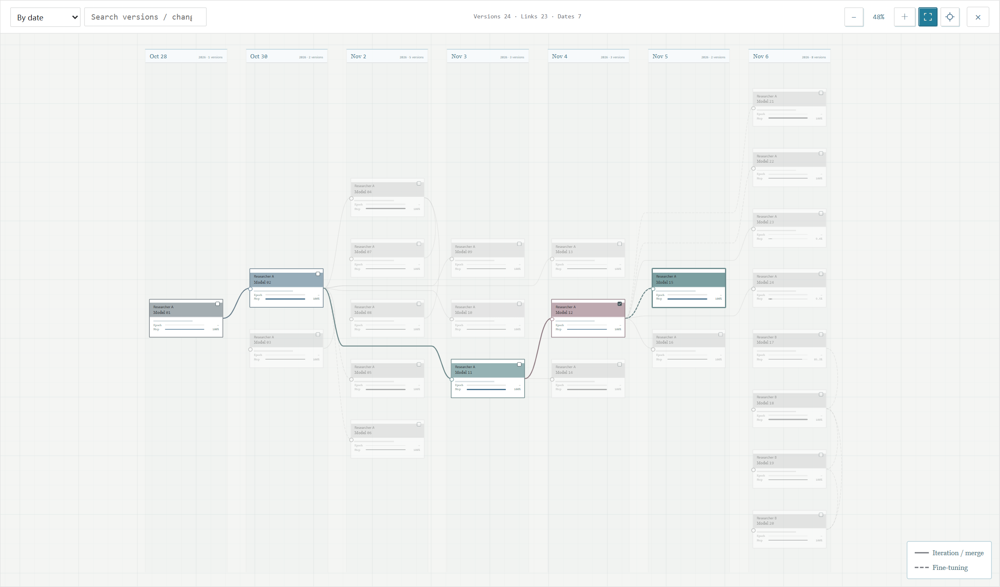
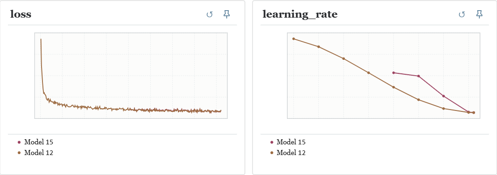
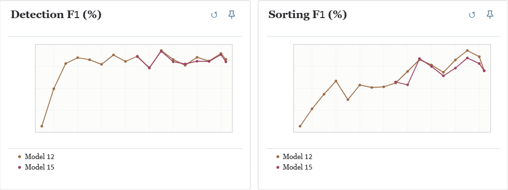

# TorchMap 🗺️

[简体中文](README.zh-CN.md)

**TorchMap is a model version map your whole team maintains together.** When someone tries a new idea, they branch a card from the model they started with and record what changed. Each card owns its training runs, configurations, checkpoints, and the validation and test results that come back later. When someone asks “Which model did that result come from?”, you can both point to the same card.



This is a snapshot of a working research project: **24 model versions, 23 relationships and two contributors across seven experiment dates**. Follow the highlighted path to Model 15. The dashed link from Model 12 marks the checkpoint continuation; the other branches stay on the same map, including two training runs still in progress at capture time. Names and change notes have been anonymized for publication.

### What can you find on a model card? 🔬

| The lab meeting question | Where to look |
| --- | --- |
| What changed since the baseline? | Select the card for its author, short change list and detailed notes. Arrange the map by date or generation to trace its ancestry. |
| Where does a second seed go? | Add a training run under the same version. Each run keeps its configuration, steps, curves and checkpoints. |
| How does this compare with our other branch? | Double-click the card to compare training curves with its direct parents. Tick another model on the map to include it. |
| We tested the 40K checkpoint yesterday. Where does that score go? | Its validation and test results link back to the producing run and plot at **40K**. The dataset, evaluation protocol and weight variant travel with the result. |

The two views below follow the same pair of cards. Model 15 joins the training history partway through Model 12’s run. Switch to Test to see how their saved checkpoints compare. The trajectories are real; exact readings and dataset labels are hidden.





### Let Codex keep the map up to date 🛠️

**TorchMap ships with a [Skill that Codex discovers in this checkout](.agents/skills/torchmap/SKILL.md).** Open the repo in Codex, point it to the shared project and your experiment outputs, and describe the change in plain language. You can skip learning the field names and filling out JSON by hand. Try:

> Use TorchMap to register my label-smoothing branch under M1. It trained from scratch. Attach the config and loss from this run. Validation and test have finished for the 40K checkpoint; link both existing results to that checkpoint and check that both appear in the viewer.

For the first integration, provide an accessible project directory and actual experiment outputs. Teammates working in other checkouts can install the [portable Skill](skills/torchmap/) and contribute to the same map.

### Try it locally 🚀

With Node.js 22 or later:

```sh
git clone https://github.com/FunkyFrog1/TorchMap.git
cd TorchMap
npm start
```

Open [the local viewer](http://127.0.0.1:18770). In a second terminal, run `node examples/walkthrough.mjs` and open the link it prints. The fictional example includes a baseline, a branch resumed from its 40K checkpoint and held-out evaluations. No GPU required. The losses are fictional too.

### Bring your own experiment 🔌

| What you have | Where to start |
| --- | --- |
| A shared directory of experiments | Run `node src/directory-server.mjs <projects-root>`. Each dated version folder becomes a card, with its own runs underneath. [Directory format (Chinese)](docs/protocol/directory-v1.zh-CN.md) |
| A script that can emit events | Run `node src/cli.mjs help` or adapt the [HTTP walkthrough](examples/walkthrough.mjs). Report metrics, register checkpoints and link evaluations to the weights you used. [Event format (Chinese)](docs/protocol/v0.1.zh-CN.md) |
| A coding agent | Open this checkout for the [discoverable skill](.agents/skills/torchmap/SKILL.md), or copy the [portable skill](skills/torchmap/) into your workspace. |

TorchMap works with any framework that writes the protocol. Existing `tensormap/…` protocol identifiers, `TENSORMAP_*` environment variables and data directories keep their original names so existing runs stay readable. Use loopback or an SSH tunnel for a shared server; the service has no built-in authentication.

**Development** · `npm ci` · `npm test` · `npx playwright install chromium` · `npm run test:ui`
[MIT license](LICENSE)
