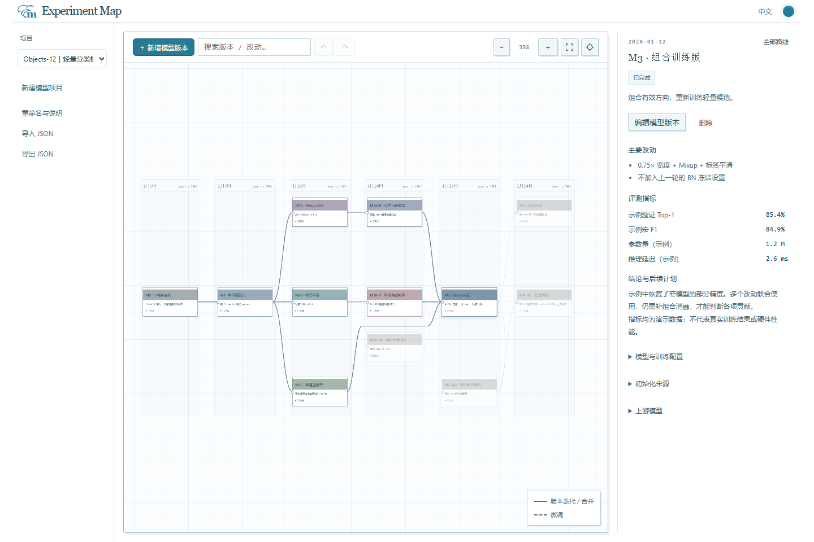
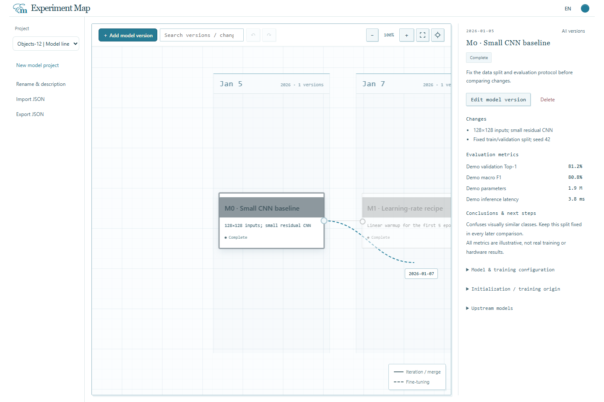

# Experiment Map

[English](README.md) · [简体中文](README.zh-CN.md)

**一个记录模型版本与继承关系的本地工具。**

把基线、架构改动、训练配方、微调来源和评测结果放在按日期排列的地图里，回看一个模型从哪些版本演变而来。



## 启动

安装 **Node.js 22 或更新版本**，在项目目录执行：

```sh
npm start
```

打开 **http://127.0.0.1:18770/**。Windows 也可双击 `start.cmd`。运行不需要安装依赖或构建；保持终端开启，按 Ctrl+C 停止。

首次启动会用虚构示例建立本地项目。更新源码时保留 `data/` 目录，即可保留已有工作项目。

## 项目与模型卡片

在**左侧栏**切换项目，也可新建、重命名、导入、导出和归档。各项目的文件、草稿和撤销记录独立。切换前等待保存完成并暂时锁定编辑；保存失败则留在原项目，可按 Ctrl+S 重试。

点击**画板工具栏的“新增模型版本”**建立模型，也可在编辑器中选择上游。卡片记录：

- 模型名称、日期、状态，以及这一版的主要改动。
- 模型与训练配置、初始化来源：从头训练或续接哪个 checkpoint。
- 评测指标、结论和后续计划。
- 可选的代码、权重或报告 HTTP(S) 链接。工具不会复制链接中的文件。

卡片显示名称、主要改动和状态；右侧详情先展示改动、指标和结论，配置、初始化来源及上游模型按需展开。保存成功时不常驻显示提示，保存中或失败时才显示状态。

## 拖圆点创建关联版本

1. 鼠标悬停在卡片上，右侧出现小圆点。
2. 从圆点拖向目标日期列，预览连线和日期随鼠标显示。
3. 靠近画板任一边缘时自动平移，越靠近边缘越快；鼠标停住也会继续移动，移回中央则停止。
4. 在画板内松手，编辑器会预填日期和当前模型作为上游；填好信息并保存后，才创建卡片和连线。

取消编辑不会改变模型图。按 Esc、取消指针、在画板外松手或窗口失焦会取消当前拖拽。开始切换项目或重建画布时，也会清除拖拽预览并停止自动平移。

日期列只显示已有模型的日期，并非连续日历刻度。拖出最左或最右的日期列后，每多延伸一列按一天预选；保存前仍可在编辑器中修改日期。键盘用户可聚焦圆点后按 Enter 或空格，打开关联版本编辑器。



## 排列与关系

同一天的模型放在同一列。按住**卡片上下拖动**可调整行位，拖到已占用的位置会交换两张卡片。位置自动保存，重开后保持；修改日期可换列。新增模型会保留已有卡片的保存行位。当前项目会话内支持撤销和重做，包括编辑、移动及新建。

点击卡片高亮全部上游，点击空白恢复所有颜色。拖动空白平移、滚轮缩放；四角展开图标显示全图，准星定位选中卡片，均有悬停说明。连线图例浮在画板右下角。

模型关系是一张**有向无环图（DAG）**。允许多个上游，但不能出现环路；编辑器会排除自身及后代作为上游的选项。

| 关系     | 含义                                              | 线型 |
| -------- | ------------------------------------------------- | ---- |
| 版本迭代 | 继承上游的方法、代码或配置，是否续接权重需注明    | 实线 |
| 微调     | 从上游权重继续训练，在初始化来源中注明 checkpoint | 虚线 |
| 合并改动 | 汇入多个模型的方法或配置，另行注明实际初始化方式  | 实线 |

连线用于记录来源。工具本身不训练模型、不合并权重、不执行评测，也不核验填写的指标；它与训练代码和 Git 仓库配合使用。

## 语言与外观

顶部 **中文 / EN** 小按钮切换界面语言；点击**主题色圆点**轮换五套配色，圆点翻转后显示新颜色。偏好保存在浏览器中，跨项目沿用，不会翻译你写的笔记或修改模型数据。

各主题使用相同的默认页面、面板和画布背景。卡片正文为白底，标题栏保留清楚的颜色区分，选中及上游状态有额外强调。

| 主题                                       | 强调配色               |
| ------------------------------------------ | ---------------------- |
| [监控台原版](docs/assets/theme-lagoon.png) | 海蓝、蓝灰与低饱和青绿 |
| [沙海驿站](docs/assets/theme-dune.png)     | 沙色、赭金与旧蓝       |
| [珊瑚轨道](docs/assets/theme-coral.png)    | 灰珊瑚与浅蓝绿         |
| [绿洲档案](docs/assets/theme-oasis.png)    | 鼠尾草绿与橄榄色       |
| [暮色电台](docs/assets/theme-dusk.png)     | 灰紫与雾蓝             |

## 示例

可导入简版 `examples/demo.zh-CN.json` / `demo.en.json`，或完整版 `examples/branching.zh-CN.json` / `branching.en.json`。虚构的 Objects-12 路线包括卷积基线、训练改动、消融、微调、未采用的 BN 冻结尝试、组合配置和随机种子复核。

数据集、模型名称、分数与延迟均为演示数据，不代表真实研究结果或硬件性能。计划中的模型不填写虚构的已完成指标。示例及截图不包含实际工作模型资料。

## 存储与分享

| 位置                      | 内容                                 |
| ------------------------- | ------------------------------------ |
| `data/project.json`       | 默认本地模型项目                     |
| `data/projects/<id>.json` | 其他本地项目                         |
| 项目旁的 `*.backup.json`  | 上一次成功保存的内容，下次保存会覆盖 |
| `data/projects/archive/`  | 归档项目和备份                       |
| `.cache/`                 | 本地日志与浏览器测试产物             |

归档从列表移除非默认项目，但保留文件；将其 JSON 从 `archive/` 移回 `projects/` 即可恢复。默认项目不能归档。导出生成可分享的 JSON 快照；**导入会替换当前项目**，需要保留两份时请先新建项目。长期备份请另行导出，单份保存备份不等于完整版本历史。多个标签页同时编辑不会自动合并。

服务只监听 `127.0.0.1`，面向可信本机上的单人使用，没有账号、遥测、外部字体下载或运行时第三方依赖，请勿直接暴露成公网多人服务。工作项目、备份、日志和依赖目录不进入 Git 及发布包。分享自己的文件前，请检查笔记和链接。

可用 `PORT` 修改端口（默认 `18770`），用 `EXPERIMENT_MAP_DATA_FILE` 指定另一份默认项目文件；额外项目放在该文件旁的 `projects/` 目录。

## 开发

```sh
npm ci
npm test
npx playwright install chromium
npm run test:ui
npm run format
```

测试使用临时项目和独立端口，不修改你的工作数据。覆盖 DAG、排列与连线、卡片和圆点拖拽、边缘平移、取消恢复、保存重开、撤销重做、慢保存和失败保存、项目切换、归档边界、主题、中英文及移动端布局。GitHub Actions 会运行核心、HTTP 和浏览器检查。

```text
src/core/       模型图结构、日期列、保存行位与连线路由
src/web/        画布、模型编辑器、主题、翻译与存储客户端
src/server.mjs  本地 HTTP 服务与原子 JSON 保存
tests/          核心、HTTP 和浏览器回归测试
examples/       虚构模型版本示例
docs/           截图、更新记录与发布说明
.github/        CI、贡献及安全说明、Issue/PR 模板
```

JSON 格式见示例：`schemaVersion` 为 1，节点 ID 唯一，日期为 `YYYY-MM-DD`；可选 `row` 保存从 0 开始的行位。配置、初始化、指标和笔记记录模型信息。连线类型为 `branch`、`finetune` 或 `merge`，导入不能形成环路。文件上限 2 MB，链接支持 HTTP(S)。

[贡献说明](.github/CONTRIBUTING.md) · [安全说明](.github/SECURITY.md) · [更新记录](docs/CHANGELOG.md) · [发布到 GitHub](docs/RELEASING.md)

## 许可证

[MIT](LICENSE) © 2026 FunkyFrog1。
