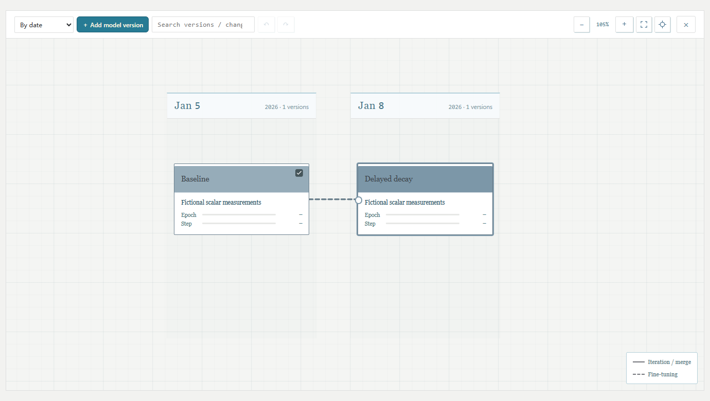

# TorchMap 🗺️

[English](README.md)

这条曲线是哪版模型跑的？评测用的又是哪一步的权重？TorchMap 把**模型版本画成路线图**，每张卡片下面挂自己的训练和评测记录。终于可以让文件夹里的「最终版_真的最终版_3」退休了。



### 顺着路线找模型 🧬

单击卡片，高亮这版模型的上游；双击进入训练页，默认叠加直接上游的曲线。想把另一条分支也拉来对照，在地图上勾选它就好。点悬浮缩略图，随时回到地图。

### 把关心的曲线钉起来 📈

训练、验证和测试分别展示。展开指标组，把关心的曲线钉到顶部；在同一个项目里换模型，图钉也跟着走。评测点按**被评权重的训练步数**落在横轴上。哪怕一次评测只跑了 32 批，40K 权重的成绩也会画在 40K。


### 在本机逛一圈 🚀

准备 Node.js 22 或更高版本，运行：

```sh
git clone https://github.com/FunkyFrog1/TorchMap.git
cd TorchMap
npm start
```

打开[本地页面](http://127.0.0.1:18770)。另开一个终端，运行 `node examples/walkthrough.mjs`，点开它打印的链接。示例包含基线、从 40K 权重续训的分支，以及留出集评测。全程不用显卡，示例里的 loss 也是编的。

### 接入自己的实验 🔌

| 手头有什么 | 怎么接入 |
| --- | --- |
| 共享盘上的实验目录 | 运行 `node src/directory-server.mjs <项目总目录>`。日期目录下每个版本对应一张卡，卡片下面可以有多个 run。[目录协议](docs/protocol/directory-v1.zh-CN.md) |
| 可以上报事件的训练脚本 | 运行 `node src/cli.mjs help`，或参考 [HTTP 示例](examples/walkthrough.mjs)，记录指标、登记权重，并指定每次评测使用的检查点。[事件协议](docs/protocol/v0.1.zh-CN.md) |
| 帮忙接实验的 AI | 在本仓库打开 Codex 即可发现 [TorchMap skill](.agents/skills/torchmap/SKILL.md)，也可以把[便携版](skills/torchmap/)复制到自己的工作区。 |

任何训练框架都可以按协议写入数据。已有的 `tensormap/…` 协议标识、`TENSORMAP_*` 环境变量和数据目录沿用原名，已有实验可以继续读取。共享部署请通过本机回环地址或 SSH 隧道访问，服务没有内置登录鉴权。

**开发** · `npm ci` · `npm test` · `npx playwright install chromium` · `npm run test:ui`
[MIT 许可证](LICENSE)
