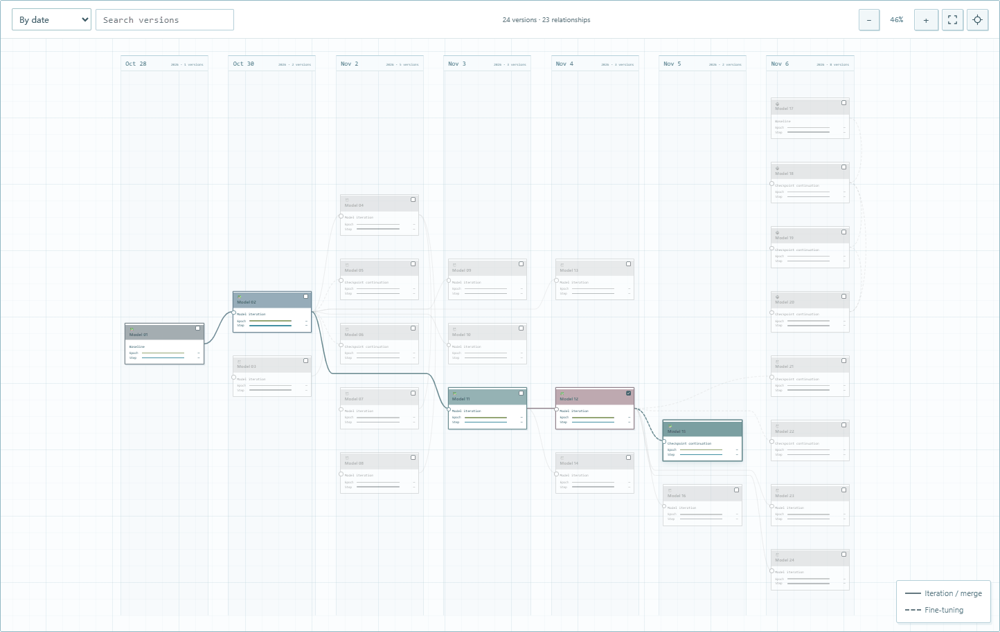
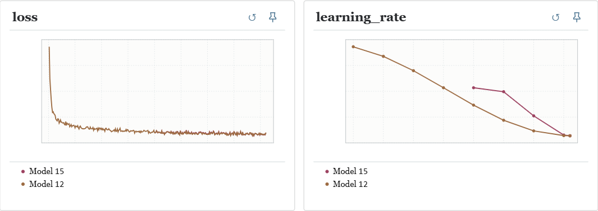

# TorchMap

[English](README.md)

TorchMap 让团队共同维护一张模型版本路线图。每张卡代表一个模型版本，记录它从哪一版演变而来、主要改了什么。打开卡片，就能查看这个版本的各次训练、配置、权重，以及对应的验证和测试结果。

<p align="center">
  <a href="docs/assets/torchmap-layouts.gif"></a>
</p>

动图取自真实研究项目的版本关系，模型名和具体改动已脱敏。🐸 和 🐵 代表两位贡献者。**按日期**看，可以知道团队在同一时期并行尝试了哪些方案；**按代数**看，同一代的分支排在一起，更容易追溯它们共同的起点。切换布局时，选中版本的上游路线持续高亮。

## 用路线图管理实验

修改模型结构或训练策略时，新建一张卡，连到上游版本，写明改动，以及这次是从头训练还是从某个 checkpoint 续训。如果只是更换随机种子重复实验，在同一张卡下新增一次运行即可。

双击卡片进入训练页，默认与直接上游比较。在地图上勾选其他卡片，还可以把更多分支加入对照。下图中，一个版本从上游的中途权重续训，两条学习率曲线从这里开始分开。

<p align="center">
  <a href="docs/assets/torchmap-curves.png"></a>
</p>

验证和测试结果挂在实际参与评测的 checkpoint 上。即使训练结束后才补测 40K 权重，得分也会出现在横轴的第 40,000 步。结果同时记录数据集、评测口径和所用权重版本，方便团队核对两条曲线能否直接比较。

## 用 Codex 接入实验

项目内置了 [Codex Skill](.agents/skills/torchmap/SKILL.md)。在 Codex 中打开仓库，提供共享项目目录和实验产物路径，就可以直接用自然语言登记模型、关联训练和补充评测。例如：

> 在 M1 下新建一个标签平滑分支，这次从头训练。挂上这次运行的配置和 loss，再把验证、测试报告关联到 40K 权重。

在其他代码仓库工作的同事，也可以安装[独立版 Skill](skills/torchmap/)，共同维护同一张图。

## 本地运行

需要 Node.js 22 或更高版本。

```sh
git clone https://github.com/FunkyFrog1/TorchMap.git
cd TorchMap
npm start
```

打开[本地页面](http://127.0.0.1:18770)。要体验完整示例，在第二个终端运行 `node examples/walkthrough.mjs`，打开它输出的地址。示例包含基线模型、从 40K 权重续训的分支和后续评测。

## 接入自己的项目

- **已有实验目录**。运行 `node src/directory-server.mjs <projects-root>` 浏览共享项目。每个日期下按模型版本建立目录，各次训练放在对应版本下。[目录协议](docs/protocol/directory-v1.zh-CN.md)
- **对接训练或评测脚本**。运行 `node src/cli.mjs help`，或参考 [HTTP 示例](examples/walkthrough.mjs)，上报指标、登记 checkpoint 并关联评测结果。[事件协议](docs/protocol/v0.1.zh-CN.md)

协议可用于不同训练框架。已有项目沿用 `tensormap/…` 协议标识和 `TENSORMAP_*` 环境变量。共享部署建议通过本机回环地址或 SSH 隧道访问，服务本身未内置身份认证。

**开发检查** · `npm ci` · `npm test` · `npx playwright install chromium` · `npm run test:ui`

[MIT 许可证](LICENSE)
