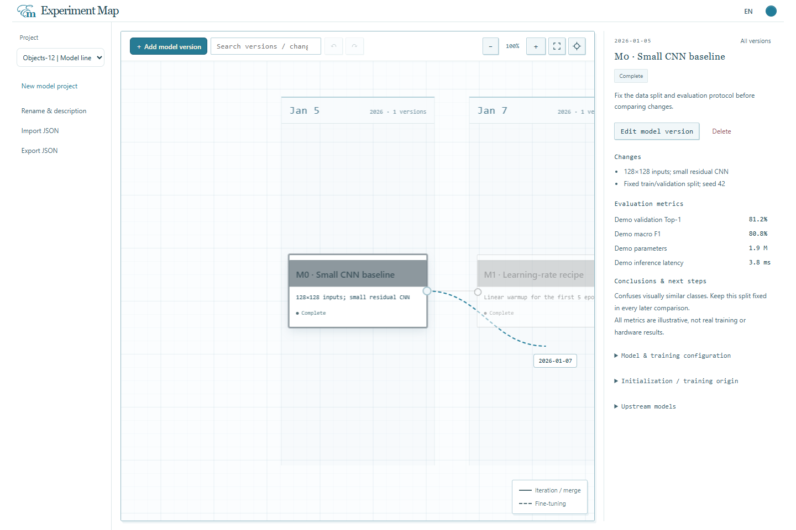

# Map interaction guide

## Drag to create a linked version

1. Hover a model card to reveal the circle on its right edge.
2. Drag the circle to a date column. A temporary wire and date label follow the pointer.
3. Hold near any canvas edge to pan automatically. The closer the edge, the faster the pan; it continues while the pointer is still. Move back to the center to stop.
4. Release inside the canvas to open the editor with the date and upstream model preselected. Fill in the model details and save to create the card and link.

Cancel the editor to leave the graph unchanged. Escape, pointer cancellation, releasing outside the canvas or losing window focus cancels the active drag. Project navigation and canvas rebuilds also clear its preview and auto-pan.

Date columns represent existing model dates, not a continuous calendar scale. Beyond the first or last column, each extra column preselects one additional calendar day. You can edit the date before saving. Keyboard users can focus a connector and press Enter or Space to open the linked-version editor without dragging.

## Layout and relationships

Models on the same date share a column. Drag a **card vertically** to set its lane; dropping on an occupied lane swaps the two cards. Positions save and survive reopening. Change the date in the editor to move columns. Adding a model preserves existing saved lanes. Undo/redo covers edits, moves and new models within the current project session.

Select a card to highlight all upstream models; click blank space to restore all colors. Pan in any direction with a two-finger trackpad scroll. Pinch to zoom around the pointer. With a mouse, drag blank space to pan and use a notched wheel to zoom; Ctrl+scroll also works with precision wheels. The four-corner icon fits the full map; the crosshair focuses the selected card. Both have hover labels. The small line legend floats at the lower right.

The model lineage is a **directed acyclic graph (DAG)**. Multiple upstream models are allowed; cycles are rejected. The editor excludes self and descendants from upstream choices.

| Relationship | Meaning                                                                                          | Line   |
| ------------ | ------------------------------------------------------------------------------------------------ | ------ |
| Iteration    | Derive a version from upstream methods, code or settings; record whether weights are reused      | Solid  |
| Fine-tuning  | Continue from upstream weights; record the checkpoint in initialization                          | Dashed |
| Merge        | Combine methods/settings from multiple versions; specify actual weight initialization separately | Solid  |

Connections document provenance. The app does not train models, combine weights, run evaluations or verify metric claims. Use it alongside your training code and Git repository.

## Language and appearance

Click **中文 / EN** in the compact header to switch interface language. Click the **colored dot** to cycle themes; it flips to show the next color. Preferences persist in your browser across projects without translating your own notes or changing model data.

All themes retain the default page, panel and canvas backgrounds. Model-card bodies are white, with distinct colored headers and selected/upstream emphasis.

| Theme                                            | Accent palette                     |
| ------------------------------------------------ | ---------------------------------- |
| [Original console](assets/theme-lagoon.png) | Sea blue, blue-gray and muted teal |
| [Dune](assets/theme-dune.png)               | Sand, ochre and weathered blue     |
| [Coral](assets/theme-coral.png)             | Dusty coral and pale blue-green    |
| [Oasis](assets/theme-oasis.png)             | Sage and olive                     |
| [Dusk](assets/theme-dusk.png)               | Muted lilac and slate blue         |
