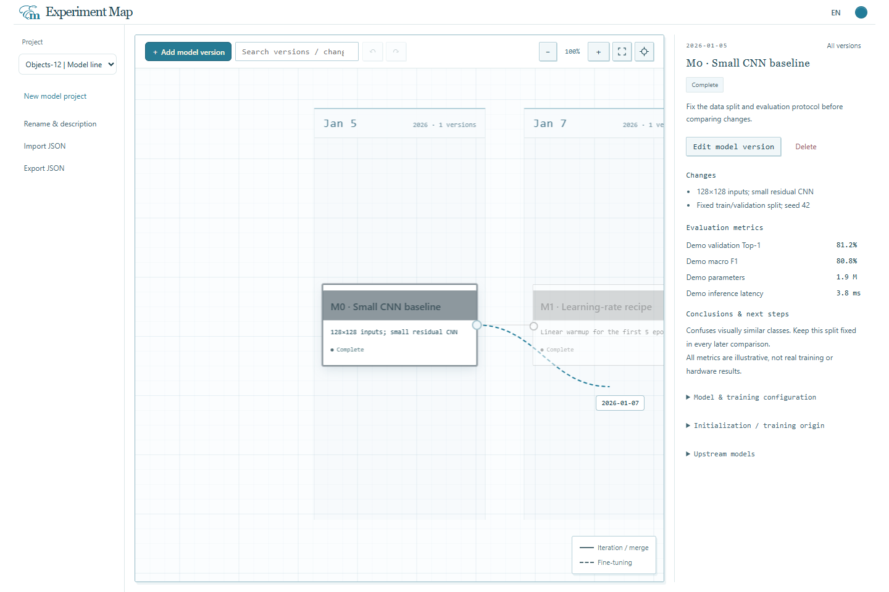

# 地图交互指南

## 拖圆点创建关联版本

1. 鼠标悬停在卡片上，右侧出现小圆点。
2. 从圆点拖向目标日期列，预览连线和日期随鼠标显示。
3. 靠近画板任一边缘时自动平移，越靠近边缘越快；鼠标停住也会继续移动，移回中央则停止。
4. 在画板内松手，编辑器会预填日期和当前模型作为上游；填好信息并保存后，才创建卡片和连线。

取消编辑不会改变模型图。按 Esc、取消指针、在画板外松手或窗口失焦会取消当前拖拽。开始切换项目或重建画布时，也会清除拖拽预览并停止自动平移。

日期列只显示已有模型的日期，并非连续日历刻度。拖出最左或最右的日期列后，每多延伸一列按一天预选；保存前仍可在编辑器中修改日期。键盘用户可聚焦圆点后按 Enter 或空格，打开关联版本编辑器。

## 排列与关系

同一天的模型放在同一列。按住**卡片上下拖动**可调整行位，拖到已占用的位置会交换两张卡片。位置自动保存，重开后保持；修改日期可换列。新增模型会保留已有卡片的保存行位。当前项目会话内支持撤销和重做，包括编辑、移动及新建。

点击卡片高亮全部上游，点击空白恢复所有颜色。拖动空白平移、滚轮缩放；四角展开图标显示全图，准星定位选中卡片，均有悬停说明。连线图例浮在画板右下角。

模型关系是一张**有向无环图（DAG）**。允许多个上游，但不能出现环路；编辑器会排除自身及后代作为上游的选项。

| 关系     | 含义                                              | 线型 |
| -------- | ------------------------------------------------- | ---- |
| 版本迭代 | 继承上游的方法、代码或配置，是否续接权重需注明    | 实线 |
| 微调     | 从上游权重继续训练，在初始化来源中注明 checkpoint | 虚线 |
| 合并改动 | 汇入多个模型的方法或配置，另行注明实际初始化方式  | 实线 |

## 语言与外观

顶部 **中文 / EN** 小按钮切换界面语言；点击**主题色圆点**轮换五套配色，圆点翻转后显示新颜色。偏好保存在浏览器中，跨项目沿用，不会翻译你写的笔记或修改模型数据。

各主题使用相同的默认页面、面板和画布背景。卡片正文为白底，标题栏保留清楚的颜色区分，选中及上游状态有额外强调。

| 主题                                       | 强调配色               |
| ------------------------------------------ | ---------------------- |
| [监控台原版](assets/theme-lagoon.png) | 海蓝、蓝灰与低饱和青绿 |
| [沙海驿站](assets/theme-dune.png)     | 沙色、赭金与旧蓝       |
| [珊瑚轨道](assets/theme-coral.png)    | 灰珊瑚与浅蓝绿         |
| [绿洲档案](assets/theme-oasis.png)    | 鼠尾草绿与橄榄色       |
| [暮色电台](assets/theme-dusk.png)     | 灰紫与雾蓝             |
